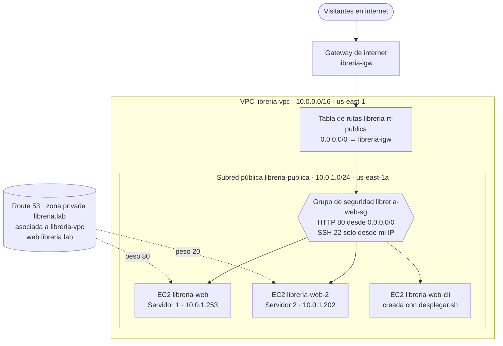

# Proyecto 1 · Mi web en AWS: Librería Tinta

**Alumno:** Cristian Antón
**Módulo:** Introducción a la Nube Pública (2º DAW)
**Entorno:** AWS Academy Learner Lab, región `us-east-1`
**Vídeo de la entrega:** [Ver vídeo](PON_AQUI_EL_ENLACE_AL_VIDEO)

## 1. Qué se ha hecho

Despliegue de la web de la librería ficticia *Librería Tinta* en una red propia dentro de AWS:

- Red propia con VPC, subred pública, gateway de internet y tabla de rutas.
- Grupo de seguridad con HTTP abierto y SSH restringido a mi IP.
- Servidor web con nginx en una instancia EC2, configurado con un script de datos de usuario.
- Estimación de costes con AWS Pricing Calculator.
- Nivel medio: segundo servidor y reparto de tráfico 80/20 con DNS ponderado en una zona privada de Route 53.
- Nivel avanzado: script `desplegar.sh` que crea el grupo de seguridad y la instancia desde la terminal con AWS CLI.

Estructura del repositorio:

```
.
├── README.md
├── img/
└── scripts/
    ├── user-data1.sh
    ├── user-data2.sh
    └── desplegar.sh
```

## 2. Arquitectura



Una VPC `libreria-vpc` (10.0.0.0/16) con una única subred pública `libreria-publica` (10.0.1.0/24, `us-east-1a`). Los dos servidores nginx están en esa subred, protegidos por el grupo de seguridad `libreria-web-sg`. Los visitantes entran por internet a través de la gateway `libreria-igw`. Dentro de la VPC, la zona privada `libreria.lab` de Route 53 reparte las consultas de `web.libreria.lab` entre los dos servidores (80 % y 20 %). La tercera instancia, `libreria-web-cli`, la crea el script del nivel avanzado con su propio grupo de seguridad.

---

## 3. Nivel básico

### B1. Red (VPC)

Creé cada recurso por separado desde la consola. No usé el asistente «VPC y más», porque puede crear una NAT Gateway que consume crédito.

| Recurso | Nombre | Configuración |
|---|---|---|
| VPC | `libreria-vpc` | CIDR `10.0.0.0/16` |
| Subred | `libreria-publica` | CIDR `10.0.1.0/24`, zona `us-east-1a`, asignación automática de IPv4 pública activada |
| Gateway de internet | `libreria-igw` | Asociada a `libreria-vpc` |
| Tabla de rutas | `libreria-rt-publica` | `10.0.0.0/16` → local y `0.0.0.0/0` → `libreria-igw`; asociada a `libreria-publica` |


**¿Por qué la subred es pública?** Lo que hace pública a una subred no es su nombre, sino su tabla de rutas: `libreria-publica` está asociada a una tabla con una ruta `0.0.0.0/0` hacia la gateway de internet, y además asigna una IP pública a sus instancias. Sin esas dos cosas, los servidores no serían accesibles desde internet. Aquí es necesario porque los visitantes de la librería tienen que llegar al servidor web.

### B2. Seguridad

Grupo de seguridad `libreria-web-sg`, dentro de `libreria-vpc`:

| Tipo | Puerto | Origen | Motivo |
|---|---|---|---|
| HTTP | 80 | `0.0.0.0/0` | La web es pública |
| SSH | 22 | Mi IP (`/32`) | Administración solo desde mi equipo |


**¿Por qué el SSH solo está abierto a mi IP?** SSH sirve para administrar el servidor, no para los visitantes. Si estuviera abierto a todo internet, el puerto 22 recibiría escaneos y ataques de fuerza bruta constantes. Limitarlo a mi IP reduce mucho la superficie de ataque, y solo yo puedo entrar para administrar. HTTP sí queda abierto porque es la función de la web.

### B3. Servidor web

| Campo | Valor |
|---|---|
| Nombre | `libreria-web` |
| Sistema | Amazon Linux 2023 |
| Tipo | `t3.micro` |
| Par de claves | `vockey` |
| Red | `libreria-vpc` / `libreria-publica` / `libreria-web-sg` |
| Etiquetas | `Proyecto = P1`, `Alumno = Cristian Antón` |
| IP privada | `10.0.1.253` |

El script [`scripts/user-data1.sh`](scripts/user-data1.sh) se ejecuta en el primer arranque. Instala nginx, lo activa y publica una página con el horario, la dirección y la recomendación de libro de la librería.


**Problemas que encontré y cómo los resolví**

1. **El texto no se veía en la web.** Dejé los marcadores `<texto>` del script alrededor de mis datos, y el navegador los interpretó como etiquetas HTML y los ocultó. Quité los `<` y `>` y creé la instancia de nuevo con el user data corregido, porque el user data solo se ejecuta en el primer arranque.
2. **El pie de página mostraba `$(hostname)` literalmente.** Al escribir el HTML con `<<'EOF'` (con comillas), Bash no sustituye las variables. En el servidor 1 lo corregí por SSH con `sed`, sustituyendo el pie por un texto fijo que lo identifica como «Servidor 1». Después corregí también `scripts/user-data1.sh` (con `<<EOF`, sin comillas), que es la versión que usa el script del nivel avanzado.

### B4. Costes

Estimación mensual de un servidor encendido 24/7 en `us-east-1`: **8,23 USD al mes** (98,76 USD al año), con una instancia `t3.micro` On-Demand, 8 GB de disco gp3 y 1 GB de transferencia de salida. La estimación no incluye la IPv4 pública, que AWS cobra aparte.

- Estimación EC2: https://calculator.aws/#/estimate?id=382f33e64b1efe728dc6875cfc1667c46bf05c6d


**Idea para reducir costes.** La web de Librería Tinta es una página estática, por lo que mantener una instancia EC2 encendida 24/7 es más de lo necesario. En un entorno real la serviría desde Amazon S3 con CloudFront por delante. Según AWS Pricing Calculator, el coste pasaría de 8,23 USD/mes a 0,13 USD/mes. Además, se elimina el cargo por la IPv4 pública, se gana HTTPS gratuito y desaparece el mantenimiento del servidor. Esta solución solo sirve mientras la web sea estática. Si necesitara usuarios o base de datos, haría falta un servidor o una arquitectura distinta. En este proyecto se usa EC2 porque el objetivo es practicar VPC, seguridad y DNS.

- Estimación S3 + CloudFront: https://calculator.aws/#/estimate?id=d0b3f97d996eb3f307420d8bab27ea7306e478e4

### B5. Documentación

Este documento.

---

## 4. Nivel medio: segundo servidor y DNS ponderado

### M1. Segundo servidor y DNS

Lancé `libreria-web-2` en la misma VPC, subred y grupo de seguridad, con [`scripts/user-data2.sh`](scripts/user-data2.sh), que muestra «Servidor 2» en la página.

| Servidor | IP privada |
|---|---|
| `libreria-web` (servidor 1) | `10.0.1.253` |
| `libreria-web-2` (servidor 2) | `10.0.1.202` |


**Configuración DNS.** Antes activé en la VPC la resolución DNS y los nombres de host DNS, que vienen desactivados al crear una VPC a mano. Después creé la zona alojada **privada** `libreria.lab` y la asocié a `libreria-vpc`, para que el nombre solo se resuelva dentro de la red. En la zona hay dos registros A con el mismo nombre, `web.libreria.lab`, e identificadores distintos:

| ID de registro | Valor (IP privada) | Peso |
|---|---|---|
| `servidor1` | 10.0.1.253 | 80 |
| `servidor2` | 10.0.1.202 | 20 |

Es un reparto ponderado: de cada 10 consultas, unas 8 devuelven el servidor 1 y unas 2 el servidor 2.


**Comprobación.** Desde el servidor 1, conectado por SSH, resolví el nombre con `nslookup` y `dig`, y lancé 30 peticiones con `curl` a `http://web.libreria.lab`:

```bash
nslookup web.libreria.lab
dig web.libreria.lab +short

for i in $(seq 1 30); do
  curl -s http://web.libreria.lab | grep -o 'Servidor [12]'
  sleep 2
done | sort | uniq -c
```

Resultado: 27 respuestas del servidor 1 y 3 del servidor 2. El reparto no es exacto porque es probabilístico.

En la primera prueba salieron 30 de 30 del servidor 1. La causa fue la caché del resolver de la VPC (`10.0.0.2`), que guarda la respuesta durante el TTL. Para la prueba bajé el TTL de 60 a 1 segundo y añadí una pausa de 2 segundos entre peticiones.


### M2. Costes con dos servidores y DNS

Con dos instancias EC2 `t3.micro` 24/7, con 8 GB de disco gp3 cada una, más una zona alojada privada de Route 53, AWS Pricing Calculator estima **17,36 USD al mes** (208,32 USD al año), frente a los 8,23 USD del servidor único. El coste de los servidores se duplica y Route 53 añade unos 0,90 USD mensuales. La estimación no incluye las IPv4 públicas. Como la calculadora solo admitía números enteros de millones de consultas, usé 1 millón, que sobrestima el tráfico real de una librería pequeña.

- Estimación con dos servidores y DNS: https://calculator.aws/#/estimate?id=fe9bbaec43c82992e16a9975dde72de62bac35a3


---

## 5. Nivel avanzado: script de despliegue

El script [`scripts/desplegar.sh`](scripts/desplegar.sh) replica B2 y B3 desde la terminal con AWS CLI. Lo ejecuté desde AWS CloudShell, con `user-data1.sh` en la misma carpeta.

**Qué hace, paso a paso**

1. Obtiene la AMI más reciente de Amazon Linux 2023 consultando un parámetro público de SSM, en lugar de escribir el ID a mano, porque cambia con el tiempo.
2. Crea el grupo de seguridad `libreria-web-cli-sg` en `libreria-vpc` y le añade dos reglas: HTTP (80) desde cualquier origen y SSH (22) solo desde mi IP.
3. Lanza una instancia `t3.micro` con la clave `vockey` en `libreria-publica`, con `user-data1.sh` como datos de usuario y las etiquetas `Name`, `Proyecto = P1` y `Alumno`.
4. Espera con `aws ec2 wait instance-running` a que la instancia esté en ejecución.
5. Obtiene su IP pública con `describe-instances` y `--query`, y muestra la URL final.

**Decisiones de diseño**

- Los recursos se llaman `libreria-web-cli-sg` y `libreria-web-cli`, para no chocar con los del nivel básico (`libreria-web-sg` y `libreria-web`), que no se pueden borrar.
- `MI_IP` se rellena con la IP que consulté desde el navegador de mi ordenador. Si el script la detectara desde CloudShell, obtendría la IP de CloudShell y no la mía, y el SSH quedaría abierto para otra máquina.
- El script usa `set -euo pipefail`, para parar al primer error, y `AWS_PAGER=""`, para que la salida no se abra en un visor que detenga la ejecución.

**Ejecución**

```bash
cd ~/despliegue
chmod +x desplegar.sh
./desplegar.sh
```


**Segunda ejecución**

Si se ejecuta una segunda vez, falla porque el grupo de seguridad ya existe (`InvalidGroup.Duplicate`). Antes hay que borrar la instancia y el grupo:

```bash
INSTANCE_ID=$(aws ec2 describe-instances \
  --filters Name=tag:Name,Values=libreria-web-cli \
            Name=instance-state-name,Values=pending,running,stopping,stopped \
  --query "Reservations[].Instances[].InstanceId" --output text)
aws ec2 terminate-instances --instance-ids $INSTANCE_ID
aws ec2 wait instance-terminated --instance-ids $INSTANCE_ID

SG_ID=$(aws ec2 describe-security-groups \
  --filters Name=group-name,Values=libreria-web-cli-sg \
  --query "SecurityGroups[0].GroupId" --output text)
aws ec2 delete-security-group --group-id $SG_ID
```

---

## 6. Uso de IA

**Herramienta:** Claude (Anthropic), en su aplicación web.

**Prompts que me resultaron útiles** (resumidos):

1. **Para la terminal de aws, región us-east-1, instancia libreria-vpc, dame el comando que sacar el ID de mi VPC y el de la subred libreria-publica.** 
aws ec2 describe-vpcs --region us-east-1 \
  --filters Name=tag:Name,Values=libreria-vpc \
  --query "Vpcs[0].VpcId" --output text

aws ec2 describe-subnets --region us-east-1 \
  --filters Name=tag:Name,Values=libreria-publica \
  --query "Subnets[0].SubnetId" --output text

**y ahora el comando para saber mi IP pública** 
Aquí hay una trampa. Consúltala desde el navegador de tu ordenador, abriendo https://checkip.amazonaws.com, y no desde CloudShell. Si la pidieras en CloudShell, obtendrías la IP de CloudShell, y el SSH quedaría abierto para ella y no para tu equipo. Apunta la IP y añádele /32, por ejemplo 88.12.34.56/32.


**Errores o propuestas incorrectas que detecté**

- **La caché del DNS.** Para probar el reparto 80/20, la IA propuso un bucle con `sudo resolvectl flush-caches` entre peticiones. Lo ejecuté y salieron 30 respuestas de 30 del servidor 1, algo casi imposible con un reparto 80/20 (menos de un 0,2 % de probabilidad). Comprobé en la salida de `nslookup` que mi servidor consulta directamente al DNS de la VPC (`10.0.0.2`), así que vaciar la caché local no servía. Lo corregí bajando el TTL de los registros a 1 segundo y añadiendo una pausa entre peticiones, y entonces sí salió un reparto de 27 y 3.
- **Marcadores `<...>` en la plantilla.** La plantilla de `user-data1.sh` que me dio la IA llevaba los datos entre `<` y `>`. Al dejarlos, el navegador los interpretaba como etiquetas HTML y los ocultaba. Lo detecté al ver la web sin esos datos, y lo corregí eliminando los `<` y `>`.


---

## 7. Vídeo

[Vídeo de 3 a 5 minutos](PON_AQUI_EL_ENLACE_AL_VIDEO): la red y el grupo de seguridad en la consola, la web y la conexión SSH, el presupuesto, las dos webs, los registros DNS y la comprobación desde una máquina, y la ejecución del script con la web resultante.
